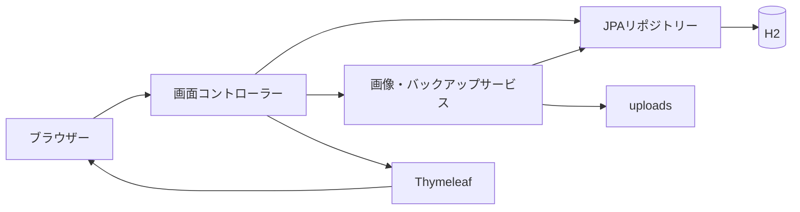
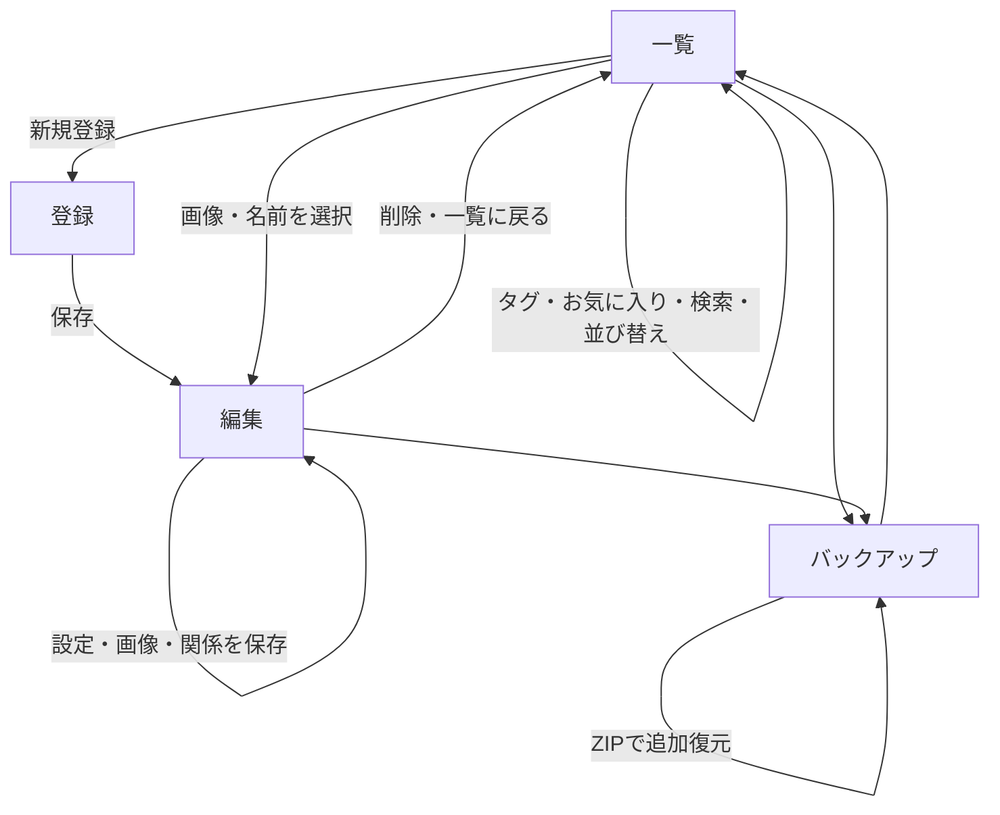

# NOCTALITH 基本設計書

| 項目 | 内容 |
| --- | --- |
| 版数 | 2.2 |
| 更新日 | 2026年11月1日 |
| 対象 | 本書と同時に保存した TennisAbe/AbeYoshihiro の character-manager |
| アプリ名 | NOCTALITH（ノクタリス） |

## 1. 目的と構成

オリジナルキャラクターのプロフィール・タグ・画像・関係をブラウザーで管理する。自分のパソコンでの利用を想定し、ログインや利用者ごとのデータ分離は実装しない。特大分類はオルタパレス・異世界・現代世界の3つに固定し、大分類は各キャラクターの所属を使う。任意の世界追加・作品別の別分類は対象外。

| 要素 | 方式 |
| --- | --- |
| アプリ | Spring Boot 4.1.2 / Java 17以上 |
| 画面 | Spring MVC / Thymeleaf / HTML / CSS |
| 演出 | 標準JavaScript / Canvas / Web Animations API |
| DB | Spring Data JPA / Hibernate / H2ファイルDB |
| 画像 | 起動ディレクトリー基準のuploadsフォルダー |
| ビルド | Maven Wrapper |
| 通常の接続先 | http://localhost:8080/ |

## 2. 機能と画面

| 画面 | URL | 機能 |
| --- | --- | --- |
| 一覧 | `/` | 名前・タグ検索、お気に入り絞り込み、並び替え、カード表示 |
| 新規登録 | `/characters/new` | 基本設定・プロフィール・タグの登録 |
| 編集 | `/characters/{id}/edit` | プロフィール更新、画像ギャラリー、代表画像選択、関係管理、削除 |
| バックアップ | `/backup` | ZIPダウンロード、ZIPからの追加復元 |
| 所属順設定 | `/affiliations/order` | 世界ごとに、使用中の所属の表示順を設定 |

## 3. 一覧・検索・お気に入り

### 3.0 世界・所属ごとの表示

特大分類は次の順番に固定し、一覧の見出しを常に表示する。

1. オルタパレスの人物
2. 異世界の人物
3. 現代世界の人物

世界内では、設定した所属順を優先し、その所属内で検索画面の並び順を適用する。所属の見出し・名前はカード一覧には追加しない。検索後も世界の順番を維持し、該当なしの区分には案内を表示する。

既存の世界未設定のキャラクターはオルタパレスに引き継ぐ。既存の所属は保持する。登録・編集画面には世界を選ぶ必須の選択欄を設け、サーバーでも3種以外を受け付けない。

### 3.0.1 所属の表示順設定

一覧の「所属の表示順を設定」から専用画面へ移動する。各世界について、現在キャラクターに使われている空欄以外の所属だけを表示する。前後空白を除去した同名の所属をまとめる。同じ所属名でも世界ごとに設定を独立させる。

上下ボタン、または1から所属数までの重複しない数値で自由に順位を指定する。保存は世界ごとに行う。JavaScript無効時も数値入力による保存は可能。

設定済みの所属を優先し、未設定の所属は、その世界で該当キャラクターのIDが古い順に末尾へ追加する。所属が空欄のキャラクターは世界内の最後に表示する。使用されなくなった所属は設定画面に出さない。保存時に使用中の所属一覧が変わっていた場合は拒否し、再読み込みを案内する。

お気に入りのみのチェック欄は横幅16pxに固定し、ラベルと8pxの間隔で隣り合わせに表示する。検索用テキスト入力のflex指定をチェックボックスに適用しない。

### 3.1 表示と番号

カードに代表画像、名前、タグ、お気に入りボタンを表示する。画像未登録の場合は専用のプレースホルダーを表示する。

NO.は内部IDではなく、現在の検索・並び替え結果の先頭から1始まりの連番とする。最低3桁で表示し、1000以上も切り詰めない。削除・絞り込み・並び替え後はその都度振り直す。内部ID・画像ファイル名は変更しない。ページ分割は行わない。

### 3.2 検索条件

| パラメーター | 仕様 |
| --- | --- |
| q | 名前の部分一致。前後空白を除去し、英字大小文字を区別しない |
| tag | タグの完全一致。英字大小文字は区別する |
| favorites | trueの場合、お気に入りだけを表示する |
| sort | oldest / newest / name / favorite |

条件はANDで併用する。名前の検索文字 `%`・`_` をワイルドカードとして扱わない。全角半角や読み仮名の独自正規化は行わない。

### 3.3 並び替え

以下の順序は、固定の世界順・ユーザー指定の所属順の後、同じ所属の中だけに適用する。

| 選択 | 順序 |
| --- | --- |
| oldest | 内部ID昇順。初期値 |
| newest | 内部ID降順 |
| name | 名前の文字順。英字大小文字を区別せず、同名はID昇順 |
| favorite | お気に入りを先頭にし、各グループ内はID昇順 |

名前順は読み仮名による五十音順ではない。未知のsort値はoldestとして扱う。

お気に入りはボタンで登録・解除し、DBに保存する。操作後も名前・タグ・並び順・お気に入り絞り込みの条件を保持する。タグクリック時も名前・並び順・お気に入り条件を引き継ぐ。

## 4. プロフィール・タグ

| 項目 | 上限 | 必須・仕様 |
| --- | --- | --- |
| 名前 | 255文字 | 必須。前後空白を除去。同名登録可 |
| 特大分類（世界） | 3択 | オルタパレス・異世界・現代世界。必須 |
| 所属 | 120文字 | 任意。作品・世界観の分類とは別のプロフィール項目 |
| 基本設定 | 12000文字 | 任意、複数行 |
| 性格 | 2000文字 | 任意、複数行 |
| 口調 | 2000文字 | 任意、複数行 |
| 一人称 | 120文字 | 任意 |
| ミカドへの思い | 4000文字 | 任意、複数行 |
| 好き | 2000文字 | 任意、複数行 |
| 嫌い | 2000文字 | 任意、複数行 |
| 能力 | 4000文字 | 任意、複数行 |
| タグ | 1個30文字・20個まで | 任意。プロフィールの後に表示 |

表の順番で登録・編集フォームに表示する。画面のセクション見出しは「プロフィール」とする。

年齢・誕生日・身長・種族・設定メモは個別の入力欄から外す。起動時にLegacyProfileMigrationが、旧設定メモと見出し付きの年齢・誕生日・身長・種族を基本設定にまとめる。既存の性格・能力・所属・画像・関係・お気に入りは変更しない。旧カラムは削除しない。

移行は基本設定がNULLの場合のみ実施し、移行済みの空文字も有効な値として扱う。利用者が空欄にして保存した内容を、次回起動時に再度埋めない。

画面とサーバーの両方で文字数を制限する。新規登録の空白名は登録画面に戻し、その他の検証エラーは入力を保持して画面内に表示する。編集時も検証エラーではDBを更新しない。

タグは半角・全角カンマ、読点、改行で区切る。前後の空白と空要素を除去し、重複をまとめる。空欄で更新すると全タグを解除する。使われなくなったタグは検索の選択肢から消える。

プロフィールフォームは表に記載した項目だけを受け付け、旧項目は送信されても変更しない。リクエストで内部ID・お気に入り・代表画像・画像登録フラグを直接変更させない。

## 5. 画像ギャラリー

### 5.1 保存・表示

1キャラクターにつき最大20枚の画像を保存する。画像には任意の説明を100文字まで付けられる。最初に登録した画像を代表画像とし、以降は「代表にする」で切り替える。

一覧と編集上部には代表画像を表示する。ギャラリーには全画像を表示し、画像を選択すると別タブで拡大表示する。

| 項目 | 制限・方式 |
| --- | --- |
| アップロード | PNG / JPEG / GIF、1枚5MB以内 |
| 画素数 | 1200万画素以内。展開前に寸法を確認 |
| 保存形式 | PNG。GIFのアニメーションは保持しない |
| 変換後サイズ | 20MB以内 |
| 保存名 | UUID.png。利用者の元ファイル名は使わない |
| 画像配信 | image/png、Cache-Control: no-store |

基本設定と画像は別フォームで保存する。画像登録時に基本設定の未保存入力は保存しない。空・非対応・破損・上限超過の画像は保存せず案内する。

### 5.2 削除

画像ごとに確認後に削除できる。代表画像を削除した場合は、残った画像のうち登録順で最初のものを代表にする。最後の画像を削除した場合は未登録状態にする。

画像操作はURLのキャラクターIDと画像の所有キャラクターを照合する。他キャラクターの画像IDを指定した操作は404とする。

### 5.3 旧画像の移行

従来の `uploads/{キャラクターID}.png` は起動時にギャラリーへ登録し、代表画像にする。ファイル自体は移動・変更しない。既に移行した画像を再登録しない。

旧画像ファイルが見つからなくても起動全体は止めない。バックアップ作成時には欠落を検出し、不完全なZIPを出力しない。旧画像もバックアップ・復元時には現在の画像制限の対象になる。

## 6. キャラクター同士の関係

このキャラクターから見た相手との関係を、方向付きで登録する。

| 項目 | 仕様 |
| --- | --- |
| 相手 | 登録済みの別キャラクター。必須 |
| 関係の種類 | 1〜60文字。家族・友人・敵対・師弟など自由記述 |
| 説明 | 任意、2000文字まで |

登録・更新・削除を可能とする。自分自身・存在しない相手への関係は作成しない。同じ相手への複数の関係を許可する。

編集画面には「このキャラクターからの関係」と「ほかのキャラクターからの関係」を表示する。相手の名前から編集画面へ移動できる。受けた関係は、登録元のキャラクターの編集画面で変更する。逆方向の関係は自動作成しない。

キャラクターを削除すると、そのキャラクターが登録元・相手になっている関係をともに削除する。

## 7. バックアップ・追加復元

### 7.1 保存

プロフィール、タグ、お気に入り、全画像、代表画像、全関係をZIPでダウンロードする。新規出力は形式バージョン3とし、ZIPにはバージョン付き `manifest.xml` と `images/{バックアップ内画像ID}.png` を入れる。世界の識別値をキャラクターに記録し、使用中の所属の順番をaffiliationOrdersとして記録する。H2の生ファイルは含めない。

画像ファイルの欠落・読み込み不能や上限超過がある場合、作成せず案内する。ZIPは暗号化しない。更新操作をしていないときにバックアップを作成する。

### 7.2 復元

現在のデータを削除せず、バックアップ内の内容を追加する。同じZIPを複数回復元すると重複追加になる。画面の確認チェックを必須とする。

バージョン1・2の旧ZIPも受け付ける。バージョン1は旧項目を基本設定へ変換し、いずれも世界はオルタパレスにする。バージョン2・3では現行プロフィール項目を全て検証する。バージョン3は世界と所属順も検証し、所属順の欠落・不正な世界・順位・未参照の所属を拒否する。古いアプリでは新しいバージョン3のZIPを復元できない。

追加復元では既存の所属順を優先する。未使用だった新しい所属は、ZIP内の順番に従って後ろに追加する。設定とキャラクターの追加は同じDBトランザクションで行い、失敗時はともに戻す。

復元時は新しい内部IDと画像保存名を生成し、代表画像と関係の参照先を新IDへ対応付ける。既存キャラクターと画像を上書きしない。

先に全内容を検証してから、DB更新を単一トランザクションで実行する。復元途中のDB処理に失敗した場合はロールバックし、今回作成した画像ファイルを削除する。

### 7.3 バックアップの上限・検証

| 項目 | 上限 |
| --- | --- |
| ZIPファイル | 100MB |
| 展開後の全内容 | 250MB |
| manifest.xml | 5MB |
| 画像1ファイル | 20MB。別途画素数・画像形式を検証 |
| ZIP内エントリー | 10000個（manifestを含む） |
| キャラクター | 5000件 |
| 関係 | 20000件 |
| 1キャラクターの画像 | 20枚 |

パストラバーサル、想定外のファイル、重複エントリー、ID重複、画像不足、未参照画像、不正な代表画像・関係参照、未知の形式バージョンを拒否する。XMLのDOCTYPE・外部エンティティ・外部スキーマを禁止する。

Web全体のmultipart上限はファイル100MB・リクエスト101MBとする。通常の画像アップロードはサービス側で引き続き5MBに制限する。

## 8. 永続データ

| テーブル | 内容 |
| --- | --- |
| original_character | ID、名前、world、新プロフィール項目、互換用の旧項目、favorite、image_registered、cover_image_id |
| affiliation_order | ID、world、所属、position。worldと所属の組み合わせを一意にする |
| character_tags | キャラクターID・タグ。組み合わせを一意にする |
| character_picture | 画像ID、所有キャラクター、保存名、説明 |
| character_relation | 関係ID、登録元キャラクター、相手キャラクター、種類、説明 |

基本設定と画像を削除する際は、先にDBの削除を確定してからファイルを削除する。ファイル削除でI/O障害が起きた場合には不要ファイルが残る可能性がある。

H2の接続先は `jdbc:h2:file:./data/characters`。`ddl-auto=update` により既存DBへカラムとテーブルを追加する。既存データのfavoriteがnullなら未登録として扱う。

`data` と `uploads` は起動ディレクトリーに依存し、Git管理対象外。ソースコードのプッシュは登録データのバックアップにはならない。

## 9. 主なURL

| メソッド | URL | 用途 |
| --- | --- | --- |
| GET | `/` | 検索・並び替え一覧 |
| GET / POST | `/characters/new` / `/characters` | 新規画面 / 登録 |
| GET | `/characters/{id}/edit` | 編集画面 |
| POST | `/characters/{id}/update` | プロフィール更新 |
| POST | `/characters/{id}/delete` | キャラクター・画像・関係削除 |
| POST | `/characters/{id}/favorite` | お気に入り切り替え |
| POST / GET | `/characters/{id}/image` | 画像追加 / 代表画像取得 |
| GET | `/characters/{id}/images/{pictureId}` | 個別画像取得 |
| POST | `/characters/{id}/images/{pictureId}/cover` | 代表画像選択 |
| POST | `/characters/{id}/images/{pictureId}/delete` | 個別画像削除 |
| POST | `/characters/{id}/relations` | 関係登録 |
| POST | `/characters/{id}/relations/{relationId}/update` | 関係更新 |
| POST | `/characters/{id}/relations/{relationId}/delete` | 関係削除 |
| GET | `/affiliations/order` | 世界ごとの所属順設定画面 |
| POST | `/affiliations/order/{world}` | 使用中の所属一覧・順位を検証して保存 |
| GET | `/backup` | バックアップ画面 |
| GET | `/backup/download` | ZIP出力 |
| POST | `/backup/restore` | 追加復元 |

## 10. デザインと演出

黒・紫・ゴールドのダークファンタジー風。独自の紋章とNOCTALITHの英字ロゴを共通ヘッダーに使用する。英字はCinzel、日本語見出しはNoto Serif JPをOFLライセンスとともに同梱する。

背景粒子、回転紋章、登場アニメーション、カードの傾き・発光、ボタンの波紋を付ける。演出のON/OFFはlocalStorageで保持し、端末の動作削減設定を優先する。非表示タブでは粒子描画を止める。JavaScript無効時も主要フォームを使用できる。

編集は760px以下で1列、一覧は500px以下で2列にする。関係管理とプロフィールはラベル付きフォームを使い、任意入力はThymeleafでエスケープして表示する。

## 11. 実装ファイル

| ファイル・クラス | 役割 |
| --- | --- |
| CharacterController / CharacterRepository | プロフィール・検索・お気に入り・並び替え・削除 |
| ProfileFields / TagParser / LegacyProfileMigration | 項目の転記・検証、タグ解析、旧プロフィールと世界の移行 |
| CharacterWorld / AffiliationOrderingService / AffiliationOrderRepository / AffiliationOrderController | 世界の定義、所属順保存、グループ別表示、設定画面 |
| CharacterImageController / GalleryService / PictureRepository | ギャラリー・代表画像・旧画像移行 |
| RelationController / RelationRepository | 方向付き関係の管理 |
| BackupController / BackupService | ZIP入出力、検証、ID再対応付け、復元 |
| OriginalCharacter / CharacterPicture / CharacterRelation | 永続データの定義 |
| index.html / character-form.html / backup.html | 各画面 |
| fragments/palace.html / style.css / palace.js | 共通ロゴ・装飾・演出 |

## 12. テストと運用

自動テストはアプリ起動1件、既存HTTP機能7件、タグ解析2件、追加機能14件、分類・所属順9件の合計33件。`mvnw verify` でテストとパッケージを作成する。テストは専用のメモリーDB・一時画像フォルダーを使用する。

| 検証対象 | 内容 |
| --- | --- |
| プロフィール | 指定の表示順、全新項目・長文の保存と更新、各項目の上限ちょうど・超過時の未更新、旧項目非表示 |
| お気に入り・並び替え | 登録・解除、4種の順序、名前・タグ・お気に入りの併用 |
| ギャラリー | 追加、画像取得、代表切り替え、削除時の繰り上げ、全削除、別キャラクターの画像操作拒否 |
| 画像の異常系 | 空・破損・非画像、5MB超過、1200万画素超過、20枚超過 |
| 関係 | 登録・更新・削除、登録元と相手の表示、自己参照拒否、所有者照合、キャラクター削除時の整理 |
| バックアップ | ダウンロード、全項目・画像・代表・関係の追加復元、ID再対応付け、確認必須 |
| 不正な復元 | 破損ZIP、危険なパス、過大な展開、DOCTYPE、形式不一致、欠落・破損画像、不正な参照 |
| 障害時の復元 | DB障害を発生させ、DBロールバックと今回作成した画像の削除を確認 |
| 分類・所属順 | 世界の固定順、所属順の世界別保存、所属内ソート、検索・お気に入り併用、新規所属追加、所属変更・世界変更、順位重複・不正・古い一覧の拒否 |
| 分類の復元 | バージョン3の世界・所属順復元、既存の並び順優先、バージョン2の既定世界、壊れた設定の拒否、設定保存障害時のロールバック |
| 互換性 | 旧画像の移行、旧プロフィールの移行・空欄保存後の再移行防止、バージョン1 ZIPの画像・関係を含む復元、バージョン2の新項目欠落拒否、旧DB更新・再起動後の保持 |

Chromiumの実操作でも、プロフィール更新・画像追加と代表切り替え・関係登録と相手側表示・お気に入り絞り込み・ZIPダウンロードと追加復元を確認した。320px・390px・768px・1440px幅で一覧・編集・バックアップ画面に横はみ出しがないことを確認した。旧形式のファイルDBと画像から起動し、更新後の再起動を繰り返して、プロフィール・お気に入り・関係・代表画像のバイト列が保持されることを確認した。

テスト実行時はtestプロファイルで画像保存先をOSの一時フォルダーへ分離する。通常のuploadsフォルダーをテストから変更しない。

手動バックアップを行う場合は、アプリを停止してdataとuploadsの両方をコピーする。アップデート時もこのコピーを残してからプル・再起動する。

## 13. 現時点の制限

- 認証・認可・CSRF対策等の公開サービス向け構成は未整備。
- 任意の世界の追加、作品別の別分類、一覧への所属見出し表示、ページ分割、読み仮名順の並び替え、関係図の描画は対象外。
- 基本設定と画像の一括保存、未保存変更の離脱警告は未実装。
- 一般の画像保存・削除とDBは単一のファイルシステムトランザクションではない。停電・プロセス強制終了・削除時のI/O障害への完全な復旧は保証しない。
- 追加復元は内容の一致検出・重複排除を行わず、既存データ置換も行わない。
- バックアップZIPはメモリー上で組み立てる。規定上限内でも空きメモリー・空きディスクが不足すると処理できない。
- 同時編集の競合検知、複数操作中の完全なバックアップスナップショット、自動バックアップ、DBマイグレーション履歴管理は未実装。

### プロフィール変更後の追加ブラウザー検証

旧プロフィールのカラムと登録済み画像があるH2ファイルから起動して、基本設定への移行、指定の入力順、新項目すべての保存・再表示、バージョン2 ZIPのダウンロード・追加復元を確認する。320px・390px・768px・1440px幅で編集画面の横はみ出しを確認し、基本設定を空にして保存した後の再起動でも旧内容が再挿入されないことを確認する。

### 分類追加後のブラウザー検証

旧世界未設定のファイルDBから起動し、世界の引き継ぎ、3つの見出しの固定順、所属の上下移動・数値検証・世界別保存、世界変更、チェック欄とラベルの距離、名前検索・お気に入りを確認する。320〜1440px幅、バージョン3 ZIPのダウンロードと追加復元、再起動後の分類・順番保持を確認する。
