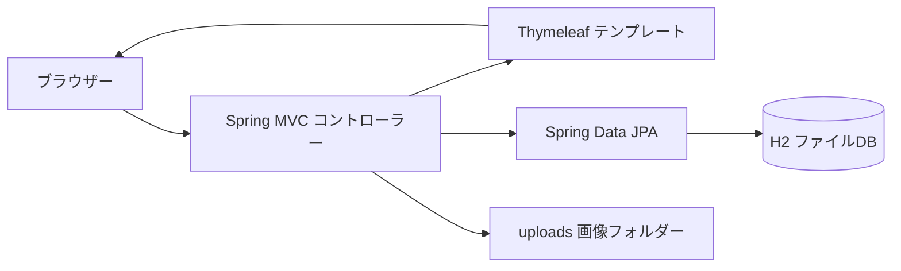
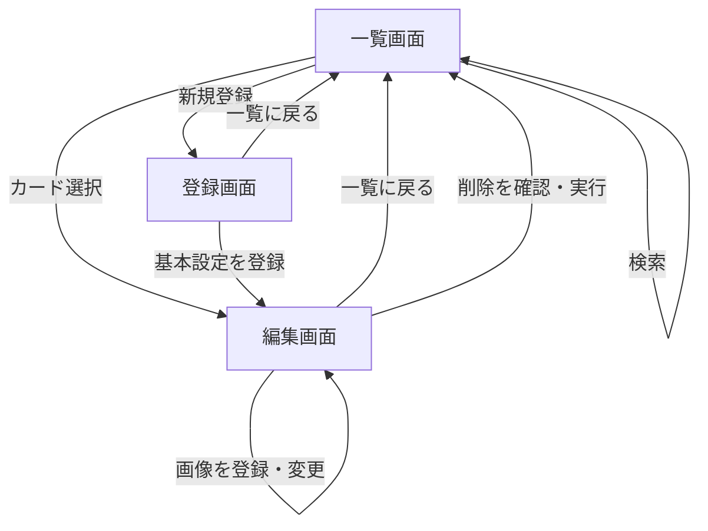

# キャラクター管理アプリ 基本設計書

| 項目 | 内容 |
| --- | --- |
| 文書版数 | 1.1 |
| 作成日 | 2026年11月1日 |
| 対象リポジトリ | TennisAbe/AbeYoshihiro |
| 対象ディレクトリー | character-manager |
| 対象実装 | タグ機能追加版（本書と同時に保存したコード） |
| 記載方針 | 現在実装されている動作を記載。未実装事項は末尾に分離する |

## 1. システム概要

オリジナルキャラクターの名前・性格・設定メモ・画像を、ブラウザーから登録・参照・更新・削除するアプリケーション。画像と名前を並べた一覧から対象を選び、専用の編集画面で設定を管理する。

現段階は自分のパソコンで利用する構成を想定する。ログイン、ユーザーごとのデータ分離、インターネット公開向けのアクセス制御は実装していない。

### 1.1 機能一覧

| ID | 機能 | 概要 |
| --- | --- | --- |
| F01 | 一覧表示 | キャラクターの画像と名前をカード表示する |
| F02 | 名前検索 | 名前の部分一致で一覧を絞り込む |
| F03 | 新規登録 | 名前・性格・設定メモを登録する |
| F04 | 編集 | 登録済みキャラクターの基本設定を更新する |
| F05 | 削除 | 確認ダイアログの後、対象データを削除する |
| F06 | 画像登録・変更 | キャラクターごとに画像1枚を登録・置換する |
| F07 | 画像表示 | 保存した画像を一覧と編集画面に表示する |
| F09 | タグ管理・検索 | 複数タグの付与・解除、タグ完全一致検索、名前との併用 |
| F08 | 永続保存 | 基本設定と画像をローカルに保存し、再起動後も使用する |

### 1.2 構成

| 要素 | 使用技術・方式 |
| --- | --- |
| 言語 | Java。pom.xml のターゲットは17、既存の検証環境はJDK 21 |
| アプリ基盤 | Spring Boot 4.1.2 / Spring MVC |
| 画面 | Thymeleaf / HTML / 共通CSS |
| データアクセス | Spring Data JPA / Hibernate |
| データベース | H2、ファイル保存 |
| ビルド | Maven Wrapper |
| 初期アクセス先 | http://localhost:8080/ |

## 2. 画面設計

### 2.1 画面一覧

| 画面ID | 画面名 | URL | テンプレート |
| --- | --- | --- | --- |
| S01 | キャラクター一覧 | `/` | `index.html` |
| S02 | キャラクター登録 | `/characters/new` | `character-form.html` |
| S03 | キャラクター編集 | `/characters/{id}/edit` | `character-form.html` |

### 2.2 画面遷移

### 2.3 S01：キャラクター一覧

| 項目・操作 | 仕様 |
| --- | --- |
| 見出し | キャラクター管理 |
| 新規登録 | S02へ遷移する |
| 検索欄 | 名前を入力。現在の検索文字列を表示する |
| 検索ボタン | GETで検索条件を送信する |
| 検索をクリア | 条件がある場合に表示。条件なしの一覧へ戻る |
| 件数 | 現在の検索結果の件数を表示する |
| カード | 画像と名前を表示。カード全体を選択するとS03へ遷移する |
| 画像未登録 | 画像の代わりに「画像未登録」を表示する |
| データなし | 条件なしでは登録案内、検索中では該当なしの案内を表示する |

表示順はID昇順。ページ分割は行わず、検索結果をすべて表示する。
一覧には基本設定の入力欄・画像アップロード欄・削除ボタンを配置しない。

### 2.4 S02：キャラクター登録

| 項目・操作 | 仕様 |
| --- | --- |
| 名前 | 必須、画面上限255文字 |
| 性格 | 任意、複数行、画面上限255文字 |
| 設定メモ | 任意、複数行、画面上限255文字 |
| 登録して編集を続ける | 基本設定を保存し、採番されたIDのS03へ遷移する |
| 画像欄 | 基本設定の登録後に画像を追加できる旨を表示する |
| 一覧に戻る | 保存せずS01へ遷移する |

### 2.5 S03：キャラクター編集

| 項目・操作 | 仕様 |
| --- | --- |
| 基本設定 | 名前・性格・設定メモの現在値を表示する |
| 変更を保存する | 基本設定を更新して同じ編集画面に戻る |
| 画像プレビュー | 登録済み画像を表示。未登録なら案内文を表示する |
| ファイル選択 | PNG・JPEG・GIFを画面上の選択候補とする |
| 画像を登録・変更する | 画像を保存して同じ編集画面に戻る |
| キャラクターを削除する | 確認後に削除し、一覧へ戻る |
| 一覧に戻る | 一覧へ戻る。検索条件は引き継がない |

基本設定と画像は別フォームで保存する。画像の保存操作では、基本設定の未保存の入力内容は保存されない。
新規登録画面と編集画面は同じテンプレートを使い、IDの有無で見出し・ボタン・画像フォーム・削除ボタンを切り替える。

### 2.6 共通UI

- 淡い紫の背景、白いカード、紫の主要ボタンを使用する。
- 一覧は画面幅に合わせたグリッド配置とし、640px以下では2列表示とする。
- 編集画面は基本設定と画像欄を横並びにし、640px以下では縦並びにする。
- 画像は縦横比を保って全体を表示する。
- 入力ラベル、検索欄のアクセシブル名、キーボード操作時のフォーカス表示を設ける。

## 3. 機能設計

### 3.1 F01・F02：一覧と検索

1. クエリパラメーター `q` を受け取る。未指定時は空文字とする。
2. 前後の空白を除去する。
3. 名前の部分一致・英字の大文字小文字を区別しない条件で検索する。
4. 結果をID昇順で表示する。

空文字の場合は全件を対象にする。検索文字の `%` や `_` は任意文字の指定ではなく、文字そのものとして扱う。タグ選択時はタグ完全一致の条件もANDで適用する。性格・設定メモは検索対象外。ひらがな・カタカナ、全角・半角を同一視する独自の正規化は行わない。

### 3.2 F03：新規登録

名前がnullまたは空白のみなら登録せず、新規登録画面へ戻る。有効な名前は前後の空白を除去する。名前・性格・設定メモを新しいエンティティへ転記して保存し、DBでIDを採番する。画像登録済みフラグは初期値falseとする。

同名キャラクターの登録を許可する。登録後は専用編集画面へ移動する。

### 3.3 F04：編集

IDで既存データを取得し、存在しない場合は404とする。有効な名前の場合、名前・性格・設定メモのみを更新する。IDと画像登録済みフラグは維持する。名前が空白のみの場合は更新せず編集画面へ戻る。

### 3.4 F05：削除

画面の確認ダイアログでキャンセルした場合は送信しない。確認した場合はIDを指定してDBのキャラクターデータを削除し、一覧へ戻る。

現在の実装では、削除時に `uploads/{id}.png` は削除しない。画像ファイルだけが保存先に残る点に留意する。

### 3.5 F06：画像登録・変更

1. 対象IDのキャラクターの存在を確認する。
2. 空ファイルを拒否する。
3. Java ImageIOで画像を読み込み、読み込めないデータを拒否する。
4. `uploads` フォルダーがなければ作成する。
5. PNGに変換し、`uploads/{id}.png` に保存する。同じIDの既存画像は上書きする。
6. DBの画像登録済みフラグをtrueにし、編集画面へ戻る。

| 項目 | 仕様 |
| --- | --- |
| 画像枚数 | キャラクターごとに1枚 |
| ファイルサイズ上限 | 5MB |
| multipartリクエスト上限 | 6MB |
| 保存形式 | PNG |
| ファイル名 | キャラクターIDから生成。元ファイル名は使用しない |
| 形式の検証 | ImageIOで読み込めるかで判定。画面の拡張子指定だけでは制限しない |
| アニメーション | 保持しない。GIF等も読み込んだ静止画をPNGとして保存する |

画像の寸法・画素数の上限、縮小処理、履歴管理はない。

### 3.6 F07：画像取得

対象キャラクターが存在し、画像登録済みフラグがtrue、かつファイルが存在するときだけ画像を返す。いずれかを満たさない場合は404とする。

レスポンスは `Content-Type: image/png`、`Cache-Control: no-store` とし、画像変更後に古い画像がキャッシュから表示されることを抑える。

## 4. データ設計

### 4.1 キャラクターデータ

エンティティは `OriginalCharacter`。テーブルとカラムはJPA/Hibernateの標準命名により作成する。標準構成でのテーブル名は `original_character`。

| 論理名 | Java項目 | 標準カラム名 | 型 | 仕様 |
| --- | --- | --- | --- | --- |
| ID | id | id | Long / BIGINT | 主キー、IDENTITYによる自動採番 |
| 名前 | name | name | String / VARCHAR(255) | 業務上必須。重複可 |
| 性格 | personality | personality | String / VARCHAR(255) | 任意 |
| 設定メモ | memo | memo | String / VARCHAR(255) | 任意 |
| 画像登録済み | imageRegistered | image_registered | Boolean / BOOLEAN | 新規時false。nullも画面上は未登録として扱う |

必須・文字数の制御は、画面と一部のコントローラー処理で行う。名前に対するDBのNOT NULL制約や、サーバー側の文字数検証は明示していない。

### 4.2 永続保存

| 保存対象 | 保存場所・設定 |
| --- | --- |
| H2 DB | `jdbc:h2:file:./data/characters` |
| DBファイル例 | `data/characters.mv.db` |
| 画像 | `uploads/{id}.png` |
| スキーマ更新 | `spring.jpa.hibernate.ddl-auto=update` |

保存先は起動時の作業ディレクトリーに依存する。同じデータを使用するため、`character-manager` ディレクトリーを基準に起動する。ソースコードはGitHubで管理するが、`data` と `uploads` はGit管理対象外とする。

## 5. URL・処理一覧

| メソッド | URL | 入力 | 正常時の応答 |
| --- | --- | --- | --- |
| GET | `/` | `q`・`tag`（いずれも任意） | 一覧HTML |
| GET | `/characters/new` | なし | 新規登録HTML |
| POST | `/characters` | name、personality、memo | 作成したキャラクターの編集画面へリダイレクト |
| GET | `/characters/{id}/edit` | ID | 編集HTML |
| POST | `/characters/{id}/update` | ID、name、personality、memo | 同じ編集画面へリダイレクト |
| POST | `/characters/{id}/delete` | ID | 一覧へリダイレクト |
| POST | `/characters/{id}/image` | ID、image（multipart） | 同じ編集画面へリダイレクト |
| GET | `/characters/{id}/image` | ID | PNG画像 |
| GET | `/style.css` | なし | 共通CSS |

状態を変更する操作にはPOSTを使い、正常終了後はGET画面へリダイレクトする。

## 6. エラー・入力制御

| ケース | 現在の動作 |
| --- | --- |
| 名前未入力 | HTMLのrequiredで送信を抑止 |
| 名前が空白のみ | サーバーでも保存しない。新規登録または編集画面へ戻る |
| 画面で255文字超を入力 | maxlengthで制限 |
| 存在しないIDの編集・更新・画像操作 | 404 |
| 画像ファイル未選択 | 画面のrequiredで抑止。空ファイルの直接送信は400 |
| ImageIOが画像として認識できない | 400 |
| 画像サイズ上限超過 | multipart処理で拒否。独自の画面内案内は未実装 |
| ファイルI/OやDB障害 | 例外をフレームワークのエラー処理へ渡す |

専用エラーページ、保存成功メッセージ、項目ごとのサーバー検証エラー表示は未実装。入力内容はThymeleafのエスケープ付き出力で表示する。

## 7. 主要ファイル

| ファイル | 役割 |
| --- | --- |
| `CharacterManagerApplication.java` | アプリケーション起動 |
| `CharacterController.java` | 一覧・検索・登録・編集・削除の画面制御 |
| `CharacterImageController.java` | 画像の登録・取得 |
| `CharacterRepository.java` | DBアクセスと名前検索 |
| `OriginalCharacter.java` | DB保存するキャラクターの定義 |
| `templates/index.html` | コンパクトな一覧画面 |
| `templates/character-form.html` | 新規登録・編集の共通画面 |
| `static/style.css` | 共通の表示スタイル |
| `application.properties` | DB保存先・画像サイズ上限等 |

Javaファイルのパッケージは `com.abeyoshihiro.character_manager`。

## 8. 運用・検証

### 8.1 起動・更新

1. `character-manager` を作業ディレクトリーとして起動する。
2. Eclipseでは `CharacterManagerApplication` をJavaアプリケーションとして実行する。
3. GitHubの変更を取り込む際はアプリを停止し、未コミット変更を確認してプルする。
4. Eclipseでプロジェクトを更新し、再起動する。

### 8.2 バックアップ

アプリ停止後、`data` と `uploads` の両方をセットでコピーする。復元時も停止状態で両方を戻し、同じ作業ディレクトリーから起動する。DBだけでは画像本体を復元できない。GitHubへのプッシュは登録データ・画像のバックアップを兼ねない。

### 8.3 検証状況

対象実装の `mvnw verify` 相当の検証で、コンテキスト起動1件・HTTP統合テスト6件・タグ解析テスト2件の合計9件が成功し、パッケージ作成が完了している。検証環境はJDK 21、コンパイルターゲットは17。

| 検証区分 | 内容 |
| --- | --- |
| 自動テスト | アプリコンテキスト起動 |
| 自動テスト | 名前の部分一致、日本語、英字大小文字、空白除去、検索文字 `%` の文字扱い、該当なし |
| 自動テスト | 一覧・新規登録・編集HTML、カードリンク、HTMLエスケープ、CSS配信 |
| 自動テスト | 登録・更新・削除、更新時の画像フラグ保持、新規登録時の画像フラグ初期化 |
| 自動テスト | 空白名の登録抑止、存在しないIDの編集・更新の404 |
| 利用者確認済み | 基本設定の登録・編集・削除、画像登録・置換、再起動後のデータ・画像保持 |

新UIのブラウザー上の見た目・実操作と、画像アップロードを含む新UI全体の操作は、ローカルへプル後の確認対象。画像登録・再起動後保持について、今回新たな自動テストを実施したことを意味しない。

## 9. 現時点の制限・今後の検討

- 認証・認可・CSRF対策を含む公開運用向けの構成は未整備。
- 一覧のページ分割、性格・メモ検索、並び替え、タグの一括名称変更・全体削除は未実装。
- 基本設定と画像の一括保存、画面移動時の未保存警告は未実装。
- サーバー側の文字数検証と、利用者向けのエラー表示の改善が必要。
- 画像の画素数制限、縮小、画像のみの削除は未実装。
- キャラクター削除後も画像ファイルが残るため、削除連動・整理処理を検討する。
- 画像ファイル保存とDB更新は単一のトランザクションではなく、途中障害時の不整合対策は未実装。
- 複数利用者による同時編集の競合検知、自動バックアップ、DBマイグレーション管理は未実装。

以上は今後の検討事項であり、本書の現行機能として提供済みとは扱わない。

## 10. タグ機能（1.1追加）

### 10.1 画面と操作

- S02・S03の基本設定フォームに「タグ」入力欄を追加する。基本設定と一緒に保存する。
- 半角カンマ、全角カンマ、読点、改行で区切り、前後の空白・空要素を除去して重複をまとめる。
- タグは1個30文字以内、1キャラクターにつき重複除去後20個以内。英字大小文字は別のタグとして扱う。
- 上限超過時は画面内にエラーを表示し、入力を保持する。DBは更新しない。
- 空欄で更新すると、そのキャラクターに付いていたタグをすべて解除する。
- S01に使用中タグの選択欄を追加する。「すべてのタグ」ではタグ条件を適用しない。
- 名前は従来の部分一致、タグは完全一致で、両方指定された場合はAND検索する。
- カードにはタグを表示する。タグクリック時は名前条件を保持し、選択したタグで絞り込む。
- 使用されなくなったタグは選択肢から消える。タグは表示順をソートする。
- 画像・名前部分のリンクは編集画面に遷移し、タグのリンクは検索に遷移する。

### 10.2 データ

`OriginalCharacter` に文字列集合 `tags` を追加し、JPAのElementCollectionで保存する。

| テーブル | カラム | 内容 |
| --- | --- | --- |
| character_tags | character_id | キャラクターID。original_character.idとの関連 |
| character_tags | tag | VARCHAR(30)、NULL不可 |

character_idとtagの組み合わせを一意とする。キャラクター削除に伴い関連するタグ行も削除される。別のタグマスターテーブルは作成しない。

起動時のスキーマ更新で新しいテーブルを作成する。従来のキャラクター行・画像ファイルは変更しない。既存キャラクターはタグなしで扱う。

`TagParser.java` が入力を正規化・検証する。フォームの受け付け項目を名前・性格・メモ・タグ入力に限定し、リクエストからID・画像フラグを変更させない。

### 10.3 追加の検証

自動テストで区切り文字、空白・重複除去、長さ・個数の境界、タグの保存・解除、完全一致検索、名前とのAND検索、入力エラー時の再表示とDB未更新、キャラクター削除に伴うタグ行削除を確認する。

一時フォルダーに旧形式のH2ファイルDBと画像を用意した起動検証で、スキーマ更新後も既存データ・画像が保持されること、および追加したタグが再起動後も残ることを確認する。
