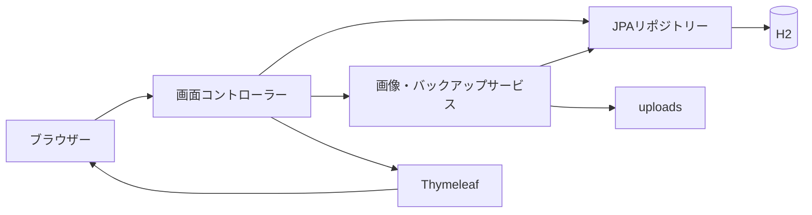
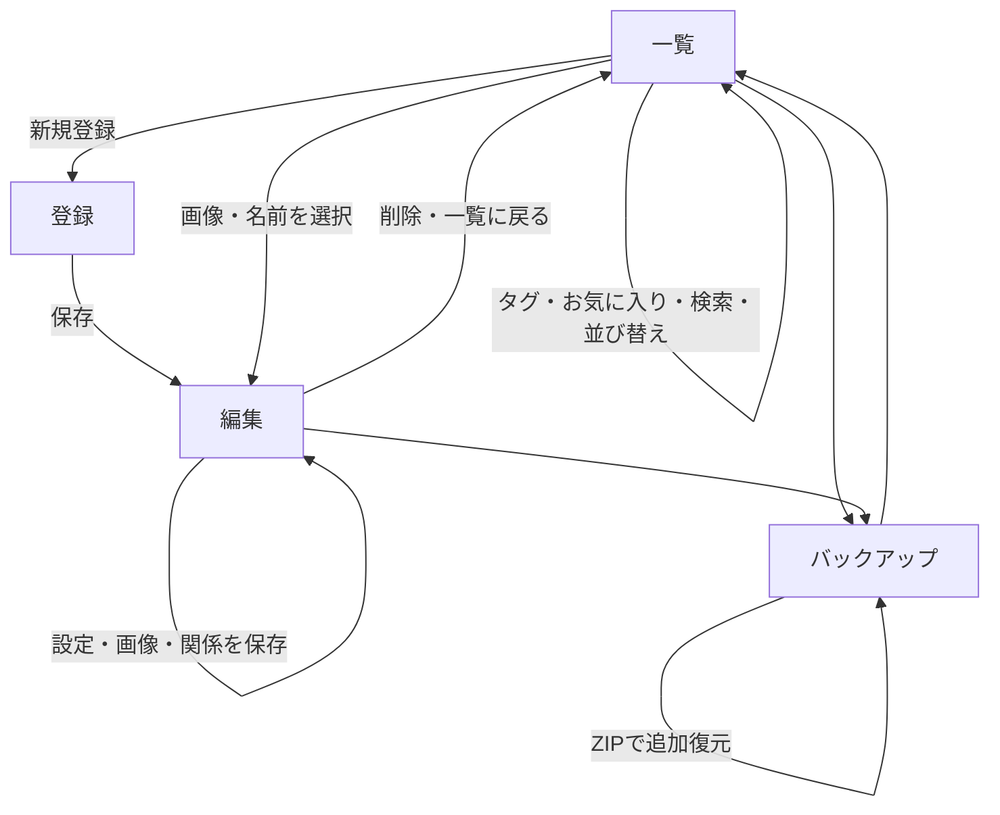

# NOCTALITH 基本設計書

| 項目 | 内容 |
| --- | --- |
| 版数 | 2.0 |
| 更新日 | 2026年11月1日 |
| 対象 | 本書と同時に保存した TennisAbe/AbeYoshihiro の character-manager |
| アプリ名 | NOCTALITH（ノクタリス） |

## 1. 目的と構成

オリジナルキャラクターのプロフィール・タグ・画像・関係をブラウザーで管理する。自分のパソコンでの利用を想定し、ログインや利用者ごとのデータ分離は実装しない。作品・世界観ごとの分類は対象外。

| 要素 | 方式 |
| --- | --- |
| アプリ | Spring Boot 4.1.2 / Java 17以上 |
| 画面 | Spring MVC / Thymeleaf / HTML / CSS |
| 演出 | 標準JavaScript / Canvas / Web Animations API |
| DB | Spring Data JPA / Hibernate / H2ファイルDB |
| 画像 | 起動ディレクトリー基準のuploadsフォルダー |
| ビルド | Maven Wrapper |
| 通常の接続先 | http://localhost:8080/ |

## 2. 機能と画面

| 画面 | URL | 機能 |
| --- | --- | --- |
| 一覧 | `/` | 名前・タグ検索、お気に入り絞り込み、並び替え、カード表示 |
| 新規登録 | `/characters/new` | 基本設定・プロフィール・タグの登録 |
| 編集 | `/characters/{id}/edit` | プロフィール更新、画像ギャラリー、代表画像選択、関係管理、削除 |
| バックアップ | `/backup` | ZIPダウンロード、ZIPからの追加復元 |

## 3. 一覧・検索・お気に入り

### 3.1 表示と番号

カードに代表画像、名前、タグ、お気に入りボタンを表示する。画像未登録の場合は専用のプレースホルダーを表示する。

NO.は内部IDではなく、現在の検索・並び替え結果の先頭から1始まりの連番とする。最低3桁で表示し、1000以上も切り詰めない。削除・絞り込み・並び替え後はその都度振り直す。内部ID・画像ファイル名は変更しない。ページ分割は行わない。

### 3.2 検索条件

| パラメーター | 仕様 |
| --- | --- |
| q | 名前の部分一致。前後空白を除去し、英字大小文字を区別しない |
| tag | タグの完全一致。英字大小文字は区別する |
| favorites | trueの場合、お気に入りだけを表示する |
| sort | oldest / newest / name / favorite |

条件はANDで併用する。名前の検索文字 `%`・`_` をワイルドカードとして扱わない。全角半角や読み仮名の独自正規化は行わない。

### 3.3 並び替え

| 選択 | 順序 |
| --- | --- |
| oldest | 内部ID昇順。初期値 |
| newest | 内部ID降順 |
| name | 名前の文字順。英字大小文字を区別せず、同名はID昇順 |
| favorite | お気に入りを先頭にし、各グループ内はID昇順 |

名前順は読み仮名による五十音順ではない。未知のsort値はoldestとして扱う。

お気に入りはボタンで登録・解除し、DBに保存する。操作後も名前・タグ・並び順・お気に入り絞り込みの条件を保持する。タグクリック時も名前・並び順・お気に入り条件を引き継ぐ。

## 4. プロフィール・タグ

| 項目 | 上限 | 必須・仕様 |
| --- | --- | --- |
| 名前 | 255文字 | 必須。前後空白を除去。同名登録可 |
| 年齢 | 40文字 | 任意。不詳などを許可する自由記述 |
| 誕生日 | 40文字 | 任意。架空の暦も許可する自由記述 |
| 身長 | 40文字 | 任意。単位を含む自由記述 |
| 種族 | 80文字 | 任意 |
| 所属 | 120文字 | 任意。作品・世界観の分類とは別のプロフィール項目 |
| 能力・特技 | 4000文字 | 任意、複数行 |
| 性格 | 2000文字 | 任意、複数行 |
| 設定メモ | 8000文字 | 任意、複数行 |
| タグ | 1個30文字・20個まで | 任意 |

画面とサーバーの両方で文字数を制限する。新規登録の空白名は登録画面に戻し、その他の検証エラーは入力を保持して画面内に表示する。編集時も検証エラーではDBを更新しない。

タグは半角・全角カンマ、読点、改行で区切る。前後の空白と空要素を除去し、重複をまとめる。空欄で更新すると全タグを解除する。使われなくなったタグは検索の選択肢から消える。

基本設定フォームは名前・プロフィール・メモ・タグだけを受け付ける。リクエストで内部ID・お気に入り・代表画像・画像登録フラグを直接変更させない。

## 5. 画像ギャラリー

### 5.1 保存・表示

1キャラクターにつき最大20枚の画像を保存する。画像には任意の説明を100文字まで付けられる。最初に登録した画像を代表画像とし、以降は「代表にする」で切り替える。

一覧と編集上部には代表画像を表示する。ギャラリーには全画像を表示し、画像を選択すると別タブで拡大表示する。

| 項目 | 制限・方式 |
| --- | --- |
| アップロード | PNG / JPEG / GIF、1枚5MB以内 |
| 画素数 | 1200万画素以内。展開前に寸法を確認 |
| 保存形式 | PNG。GIFのアニメーションは保持しない |
| 変換後サイズ | 20MB以内 |
| 保存名 | UUID.png。利用者の元ファイル名は使わない |
| 画像配信 | image/png、Cache-Control: no-store |

基本設定と画像は別フォームで保存する。画像登録時に基本設定の未保存入力は保存しない。空・非対応・破損・上限超過の画像は保存せず案内する。

### 5.2 削除

画像ごとに確認後に削除できる。代表画像を削除した場合は、残った画像のうち登録順で最初のものを代表にする。最後の画像を削除した場合は未登録状態にする。

画像操作はURLのキャラクターIDと画像の所有キャラクターを照合する。他キャラクターの画像IDを指定した操作は404とする。

### 5.3 旧画像の移行

従来の `uploads/{キャラクターID}.png` は起動時にギャラリーへ登録し、代表画像にする。ファイル自体は移動・変更しない。既に移行した画像を再登録しない。

旧画像ファイルが見つからなくても起動全体は止めない。バックアップ作成時には欠落を検出し、不完全なZIPを出力しない。旧画像もバックアップ・復元時には現在の画像制限の対象になる。

## 6. キャラクター同士の関係

このキャラクターから見た相手との関係を、方向付きで登録する。

| 項目 | 仕様 |
| --- | --- |
| 相手 | 登録済みの別キャラクター。必須 |
| 関係の種類 | 1〜60文字。家族・友人・敵対・師弟など自由記述 |
| 説明 | 任意、2000文字まで |

登録・更新・削除を可能とする。自分自身・存在しない相手への関係は作成しない。同じ相手への複数の関係を許可する。

編集画面には「このキャラクターからの関係」と「ほかのキャラクターからの関係」を表示する。相手の名前から編集画面へ移動できる。受けた関係は、登録元のキャラクターの編集画面で変更する。逆方向の関係は自動作成しない。

キャラクターを削除すると、そのキャラクターが登録元・相手になっている関係をともに削除する。

## 7. バックアップ・追加復元

### 7.1 保存

プロフィール、タグ、お気に入り、全画像、代表画像、全関係をZIPでダウンロードする。ZIPにはバージョン付き `manifest.xml` と `images/{バックアップ内画像ID}.png` を入れる。H2の生ファイルは含めない。

画像ファイルの欠落・読み込み不能や上限超過がある場合、作成せず案内する。ZIPは暗号化しない。更新操作をしていないときにバックアップを作成する。

### 7.2 復元

現在のデータを削除せず、バックアップ内の内容を追加する。同じZIPを複数回復元すると重複追加になる。画面の確認チェックを必須とする。

復元時は新しい内部IDと画像保存名を生成し、代表画像と関係の参照先を新IDへ対応付ける。既存キャラクターと画像を上書きしない。

先に全内容を検証してから、DB更新を単一トランザクションで実行する。復元途中のDB処理に失敗した場合はロールバックし、今回作成した画像ファイルを削除する。

### 7.3 バックアップの上限・検証

| 項目 | 上限 |
| --- | --- |
| ZIPファイル | 100MB |
| 展開後の全内容 | 250MB |
| manifest.xml | 5MB |
| 画像1ファイル | 20MB。別途画素数・画像形式を検証 |
| ZIP内エントリー | 10000個（manifestを含む） |
| キャラクター | 5000件 |
| 関係 | 20000件 |
| 1キャラクターの画像 | 20枚 |

パストラバーサル、想定外のファイル、重複エントリー、ID重複、画像不足、未参照画像、不正な代表画像・関係参照、未知の形式バージョンを拒否する。XMLのDOCTYPE・外部エンティティ・外部スキーマを禁止する。

Web全体のmultipart上限はファイル100MB・リクエスト101MBとする。通常の画像アップロードはサービス側で引き続き5MBに制限する。

## 8. 永続データ

| テーブル | 内容 |
| --- | --- |
| original_character | ID、名前、各プロフィール項目、性格、メモ、favorite、image_registered、cover_image_id |
| character_tags | キャラクターID・タグ。組み合わせを一意にする |
| character_picture | 画像ID、所有キャラクター、保存名、説明 |
| character_relation | 関係ID、登録元キャラクター、相手キャラクター、種類、説明 |

基本設定と画像を削除する際は、先にDBの削除を確定してからファイルを削除する。ファイル削除でI/O障害が起きた場合には不要ファイルが残る可能性がある。

H2の接続先は `jdbc:h2:file:./data/characters`。`ddl-auto=update` により既存DBへカラムとテーブルを追加する。既存データのfavoriteがnullなら未登録として扱う。

`data` と `uploads` は起動ディレクトリーに依存し、Git管理対象外。ソースコードのプッシュは登録データのバックアップにはならない。

## 9. 主なURL

| メソッド | URL | 用途 |
| --- | --- | --- |
| GET | `/` | 検索・並び替え一覧 |
| GET / POST | `/characters/new` / `/characters` | 新規画面 / 登録 |
| GET | `/characters/{id}/edit` | 編集画面 |
| POST | `/characters/{id}/update` | プロフィール更新 |
| POST | `/characters/{id}/delete` | キャラクター・画像・関係削除 |
| POST | `/characters/{id}/favorite` | お気に入り切り替え |
| POST / GET | `/characters/{id}/image` | 画像追加 / 代表画像取得 |
| GET | `/characters/{id}/images/{pictureId}` | 個別画像取得 |
| POST | `/characters/{id}/images/{pictureId}/cover` | 代表画像選択 |
| POST | `/characters/{id}/images/{pictureId}/delete` | 個別画像削除 |
| POST | `/characters/{id}/relations` | 関係登録 |
| POST | `/characters/{id}/relations/{relationId}/update` | 関係更新 |
| POST | `/characters/{id}/relations/{relationId}/delete` | 関係削除 |
| GET | `/backup` | バックアップ画面 |
| GET | `/backup/download` | ZIP出力 |
| POST | `/backup/restore` | 追加復元 |

## 10. デザインと演出

黒・紫・ゴールドのダークファンタジー風。独自の紋章とNOCTALITHの英字ロゴを共通ヘッダーに使用する。英字はCinzel、日本語見出しはNoto Serif JPをOFLライセンスとともに同梱する。

背景粒子、回転紋章、登場アニメーション、カードの傾き・発光、ボタンの波紋を付ける。演出のON/OFFはlocalStorageで保持し、端末の動作削減設定を優先する。非表示タブでは粒子描画を止める。JavaScript無効時も主要フォームを使用できる。

編集は760px以下で1列、一覧は500px以下で2列にする。関係管理とプロフィールはラベル付きフォームを使い、任意入力はThymeleafでエスケープして表示する。

## 11. 実装ファイル

| ファイル・クラス | 役割 |
| --- | --- |
| CharacterController / CharacterRepository | プロフィール・検索・お気に入り・並び替え・削除 |
| ProfileFields / TagParser | 項目の転記・検証、タグ解析 |
| CharacterImageController / GalleryService / PictureRepository | ギャラリー・代表画像・旧画像移行 |
| RelationController / RelationRepository | 方向付き関係の管理 |
| BackupController / BackupService | ZIP入出力、検証、ID再対応付け、復元 |
| OriginalCharacter / CharacterPicture / CharacterRelation | 永続データの定義 |
| index.html / character-form.html / backup.html | 各画面 |
| fragments/palace.html / style.css / palace.js | 共通ロゴ・装飾・演出 |

## 12. テストと運用

自動テストはアプリ起動1件、既存HTTP機能7件、タグ解析2件、追加機能10件の合計20件。`mvnw verify` でテストとパッケージを作成する。テストは専用のメモリーDB・一時画像フォルダーを使用する。

| 検証対象 | 内容 |
| --- | --- |
| プロフィール | 全追加項目・長文の保存、更新、文字数超過時の未更新 |
| お気に入り・並び替え | 登録・解除、4種の順序、名前・タグ・お気に入りの併用 |
| ギャラリー | 追加、画像取得、代表切り替え、削除時の繰り上げ、全削除、別キャラクターの画像操作拒否 |
| 画像の異常系 | 空・破損・非画像、5MB超過、1200万画素超過、20枚超過 |
| 関係 | 登録・更新・削除、登録元と相手の表示、自己参照拒否、所有者照合、キャラクター削除時の整理 |
| バックアップ | ダウンロード、全項目・画像・代表・関係の追加復元、ID再対応付け、確認必須 |
| 不正な復元 | 破損ZIP、危険なパス、過大な展開、DOCTYPE、形式不一致、欠落・破損画像、不正な参照 |
| 障害時の復元 | DB障害を発生させ、DBロールバックと今回作成した画像の削除を確認 |
| 互換性 | 旧画像の移行と再実行時の重複防止、旧DB更新・再起動後の保持 |

Chromiumの実操作でも、プロフィール更新・画像追加と代表切り替え・関係登録と相手側表示・お気に入り絞り込み・ZIPダウンロードと追加復元を確認した。320px・390px・768px・1440px幅で一覧・編集・バックアップ画面に横はみ出しがないことを確認した。旧形式のファイルDBと画像から起動し、更新後の再起動を繰り返して、プロフィール・お気に入り・関係・代表画像のバイト列が保持されることを確認した。

テスト実行時はtestプロファイルで画像保存先をOSの一時フォルダーへ分離する。通常のuploadsフォルダーをテストから変更しない。

手動バックアップを行う場合は、アプリを停止してdataとuploadsの両方をコピーする。アップデート時もこのコピーを残してからプル・再起動する。

## 13. 現時点の制限

- 認証・認可・CSRF対策等の公開サービス向け構成は未整備。
- 作品・世界観の分類、ページ分割、読み仮名順の並び替え、関係図の描画は対象外。
- 基本設定と画像の一括保存、未保存変更の離脱警告は未実装。
- 一般の画像保存・削除とDBは単一のファイルシステムトランザクションではない。停電・プロセス強制終了・削除時のI/O障害への完全な復旧は保証しない。
- 追加復元は内容の一致検出・重複排除を行わず、既存データ置換も行わない。
- バックアップZIPはメモリー上で組み立てる。規定上限内でも空きメモリー・空きディスクが不足すると処理できない。
- 同時編集の競合検知、複数操作中の完全なバックアップスナップショット、自動バックアップ、DBマイグレーション履歴管理は未実装。
