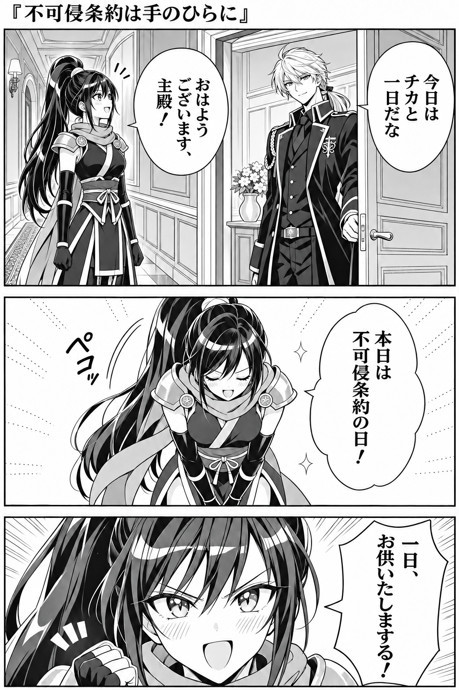

# 不可侵条約は手のひらに

チカとミカドの伊香保日帰り旅行。ユーザー提供の未完台本をもとに、後半を創作して全30ページにしました。2026年11月15日制作。白黒・右から左に読む漫画です。

## PDFで読む

- [前編：1〜15ページ](NOCTALITH-chika-ikaho-treaty-part-1-pages-01-15.pdf)
- [後編：16〜30ページ](NOCTALITH-chika-ikaho-treaty-part-2-pages-16-30.pdf)

GitHubのPDF画面で表示されない場合は「Download raw file（↓）」から保存してください。各PDFは100MB未満です。

## 内容と原作の範囲

朝の約束、服選び、手つなぎ、バイクで伊香保へ、石段街の会話まで台本を漫画向けに再構成しています。21ページの嫉妬の台詞を受け、チカがたしなめる場面から続きを創作。石段を一緒に登り、参拝と休息、別々の温泉、記念品の贈り物、帰路・パレス帰還で完結します。新しい場所や小物は今回の物語の演出で、キャラ登録設定の変更ではありません。

参考漫画の簡潔な鼻口・目の強弱・髪の面と白いハイライト・頬の斜線・表情の落差、引きとアップ、デフォルメの切替を意識しました。追加カラー見本も顔の作画参考として併用。参照した原画像の一覧とハッシュは `source-manifest.json`、詳細は [制作メモ](production-notes.md) にあります。原作漫画の人物や台詞は転載していません。

## 最初のページ

## 個別ページと構成

| ページ | 内容 | 感情の変化 | 原作・続編 |
| --- | --- | --- | --- |
| [01](page-01.png) | 朝の約束 | 期待→緊張 | 台本を漫画用に再構成 |
| [02](page-02.png) | 伊香保へ | 驚き→暴走 | 台本を漫画用に再構成 |
| [03](page-03.png) | 極楽浄土 | 気負い→素直 | 台本を漫画用に再構成 |
| [04](page-04.png) | 鉄の馬 | 興奮→照れ | 台本を漫画用に再構成 |
| [05](page-05.png) | 偶然の座標 | 対抗心→照れ隠し | 台本を漫画用に再構成 |
| [06](page-06.png) | いってきます | 安堵→出発 | 台本を漫画用に再構成 |
| [07](page-07.png) | 現代の衣服 | 戸惑い→赤面 | 台本を漫画用に再構成 |
| [08](page-08.png) | 最初の試着 | 不安→安心 | 台本を漫画用に再構成 |
| [09](page-09.png) | スポーティー | 緊張→喜び | 台本を漫画用に再構成 |
| [10](page-10.png) | 一生の服 | 大げさ→ツッコミ | 台本を漫画用に再構成 |
| [11](page-11.png) | 手をつなごう | 不意打ち→硬直 | 台本を漫画用に再構成 |
| [12](page-12.png) | 護衛のため | 狼狽→意志 | 台本を漫画用に再構成 |
| [13](page-13.png) | 現代の馬 | 好奇心→慎重 | 台本を漫画用に再構成 |
| [14](page-14.png) | 兜の装着 | 真剣→照れ | 台本を漫画用に再構成 |
| [15](page-15.png) | 離すなよ | 緊張→驚き | 台本を漫画用に再構成 |
| [16](page-16.png) | 風といっしょに | 恐怖→解放 | 台本を漫画用に再構成 |
| [17](page-17.png) | 伊香保到着 | 達成→感嘆 | 台本を漫画用に再構成 |
| [18](page-18.png) | 平和な街 | 警戒→穏やか | 台本を漫画用に再構成 |
| [19](page-19.png) | 綺麗だから | 警戒→赤面 | 台本を漫画用に再構成 |
| [20](page-20.png) | 武骨者の笑顔 | 自己否定→受容 | 台本を漫画用に再構成 |
| [21](page-21.png) | 守る相手 | 独占欲→制止 | 台本末尾＋創作接続 |
| [22](page-22.png) | 隣にいる日 | 真剣→通じ合う | 未完部分の創作続編 |
| [23](page-23.png) | 三百六十五段 | 習慣→対等 | 未完部分の創作続編 |
| [24](page-24.png) | 願いごと | 静けさ→願い | 未完部分の創作続編 |
| [25](page-25.png) | まだ命令待ち？ | 従う→望む | 未完部分の創作続編 |
| [26](page-26.png) | 湯けむりの休息 | 緊張→安らぎ | 未完部分の創作続編 |
| [27](page-27.png) | 結びの贈りもの | 勇気→共有 | 未完部分の創作続編 |
| [28](page-28.png) | 言葉を選ぶ | 決意→告白 | 未完部分の創作続編 |
| [29](page-29.png) | 帰りの約束 | 不安→確信 | 未完部分の創作続編 |
| [30](page-30.png) | 条約はまた明日 | 帰還→余韻 | 未完部分の創作続編 |

## 保存物と確認

- `page-01.png`〜`page-30.png`：生成・修正後の原稿。画像生成以外の描画変更は加えていません。
- PDF前後編、`pages.json`：ページ順、寸法、容量とSHA-256。
- `source-script.txt`：ユーザー提供原文。`storyboard.json`：ページごとの制作指示と原作／続編の区分。
- `production-notes.md`・`qa-report.json`・`build_pdf.py`：制作方針、確認範囲、PDF再構築スクリプト。

全30ページを目視し、髪型・主要衣装・話者・手・場面の接続を確認。第1ページの訪問者と部屋の位置関係、第8ページのチカの名前表記を画像生成で修正しています。PDFの15ページ×2冊、原稿の破損・欠番・重複ハッシュ・PDF埋込画像と原稿の画素一致を機械検証しています。

パーカーの前開きや胸元の小マークなど、生成による細かな描き分けはページ間に残っています。実景の伊香保や車種・建物・衣服の製図としての厳密な再現ではありません。ユーザーレビュー未受領。
