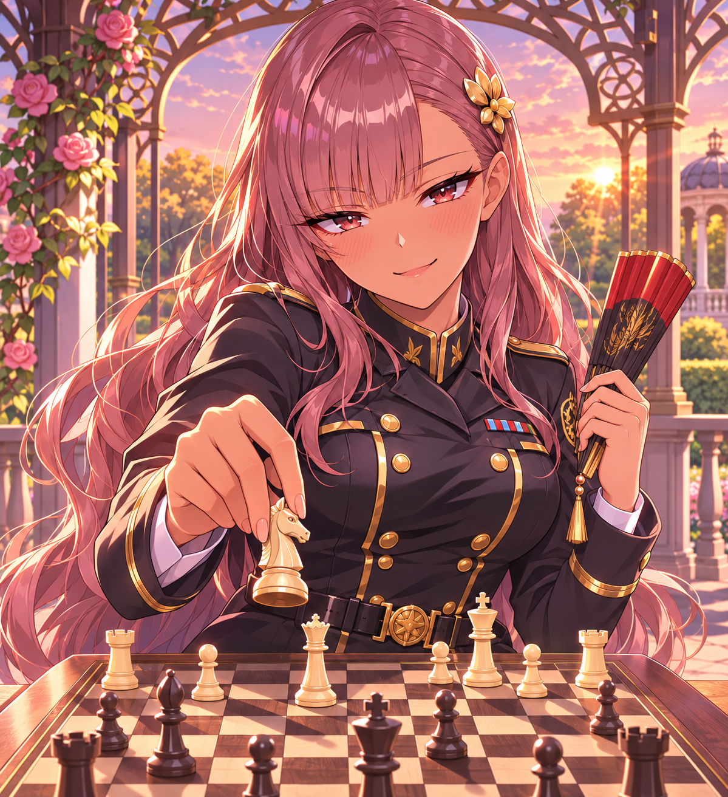
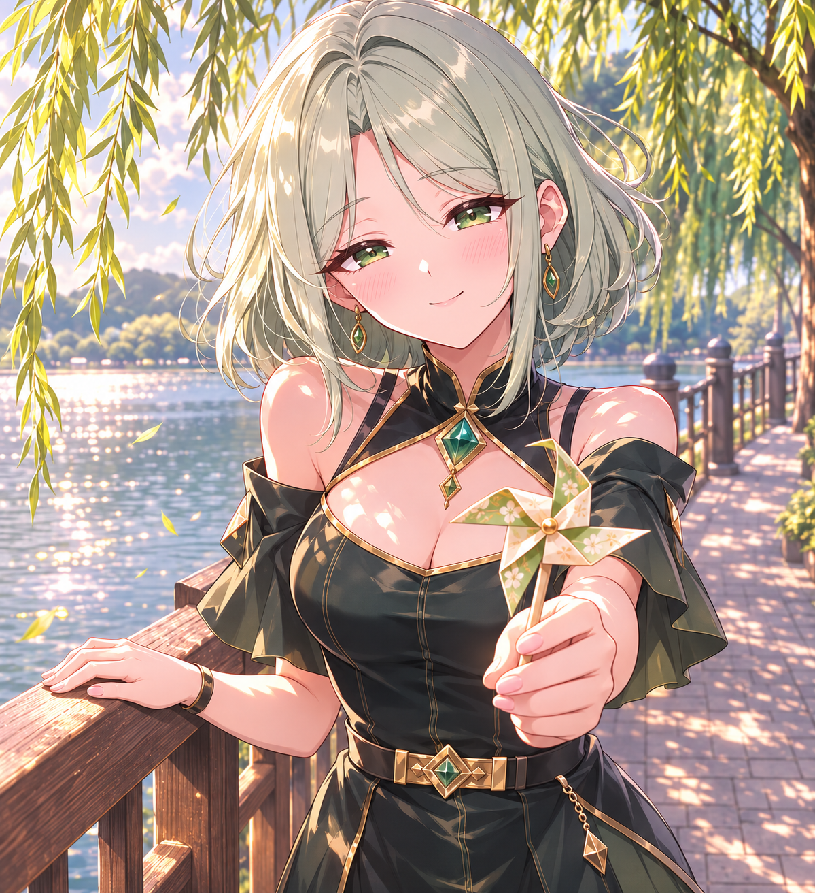
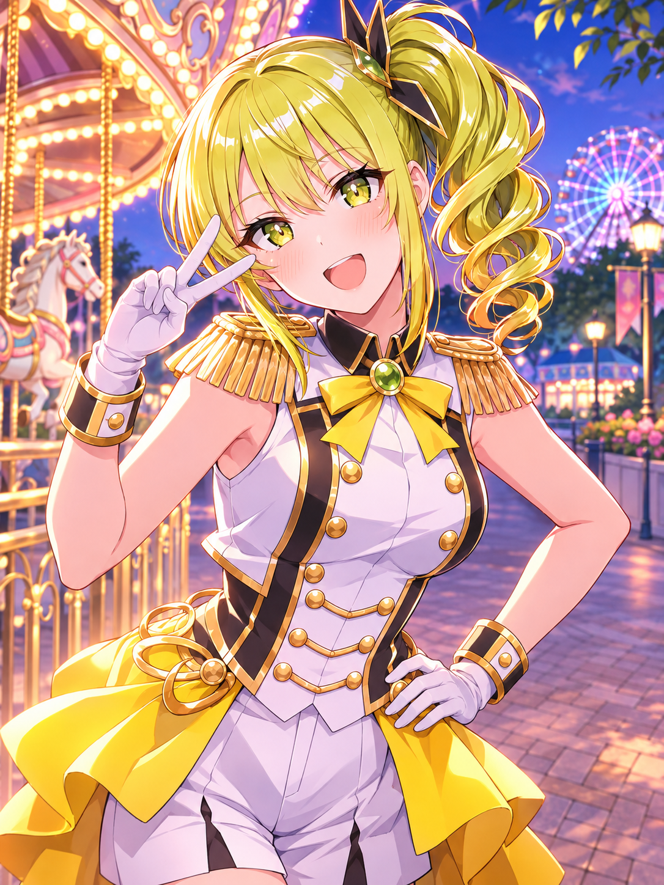
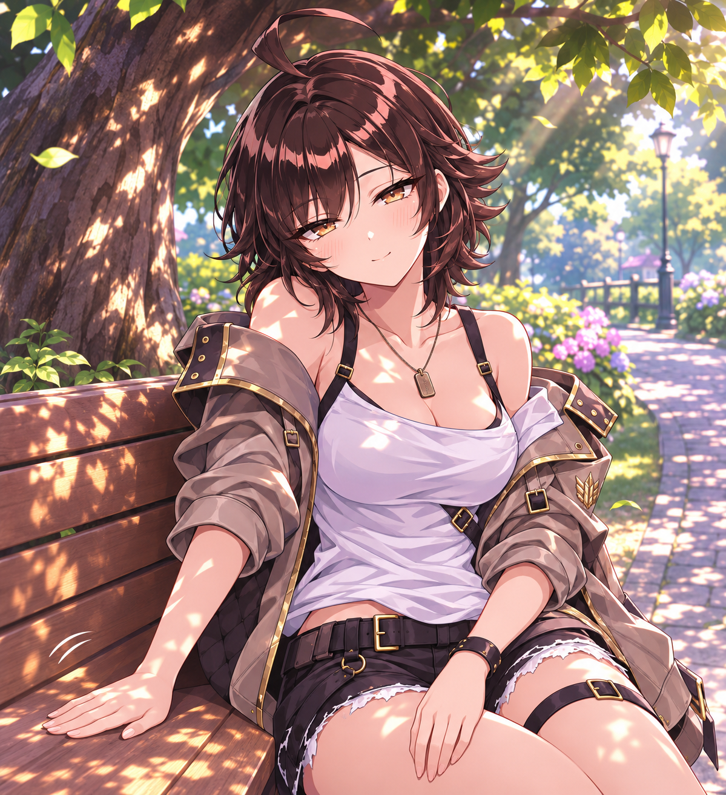
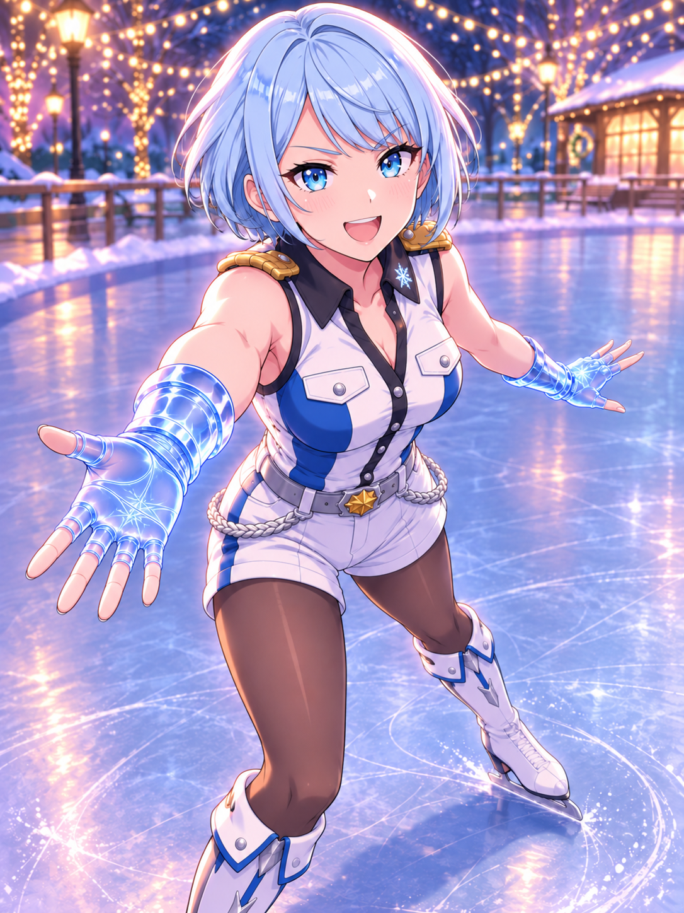
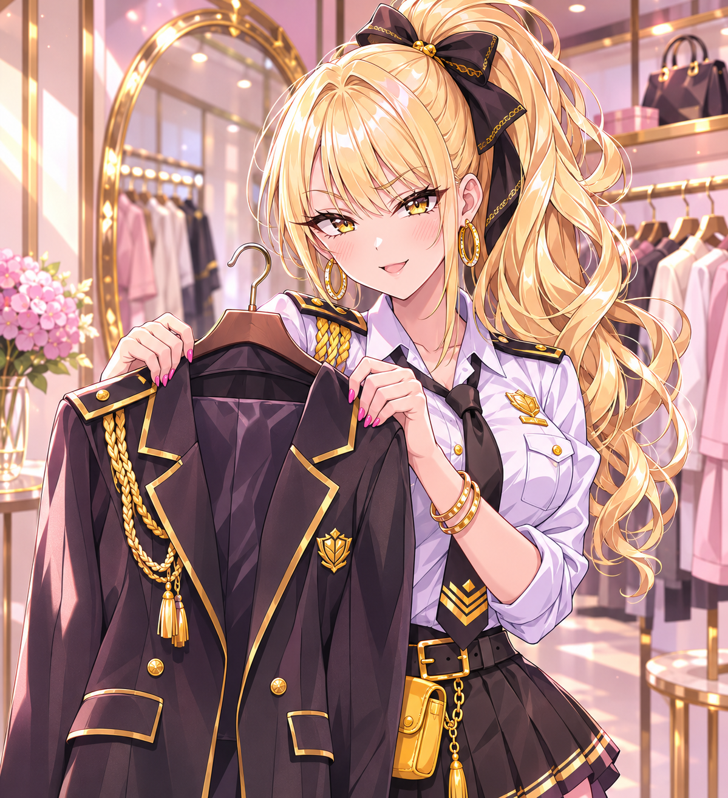
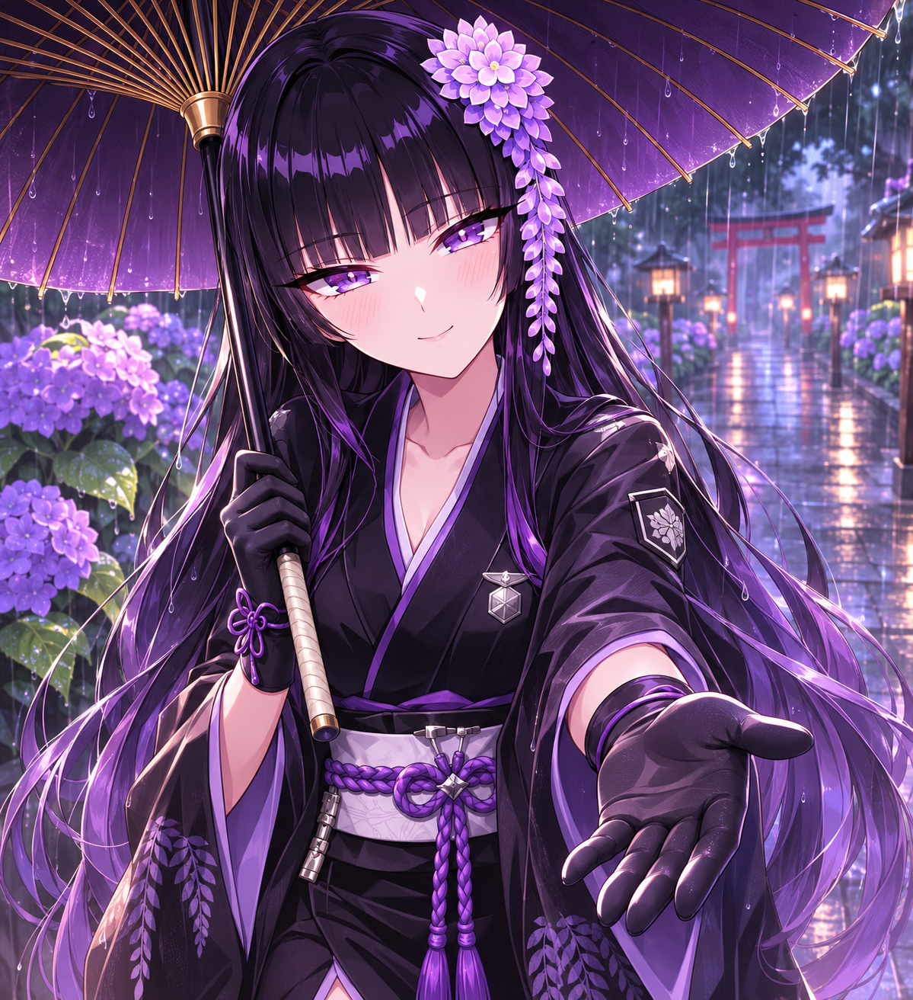

# 副官とのデート — ミカド目線

2026年11月15日制作。副官8人それぞれ1枚、計8枚のカラー一枚絵。ユーザー指定で食事系を使わず、飲食物も登場させていません。前作同様ミカド目線で、彼自身は画面外です。

キャラの登録原画像・設定と `../reference-images/100kano-kyusai-all/` の01・38を参照。登録衣装を基準としています。デートの場所と小物は今回の演出で、登録設定の追加ではありません。ユーザーレビュー未受領。

## シュカ：夕暮れの庭園でチェス

## セイラ：植物園の温室で花を観察

## パラム：湖畔で紙の風車を贈る

## ルア：夕暮れの遊園地

## クイナ：木陰のベンチでひと休み

## ソルベ：イルミネーションのスケートリンク

## ルミ：ブティックで服選び

## シノ：雨の参道で相合傘

## 確認・修正

全8枚の表示を目視確認し、PNGのデコード・寸法・SHA-256を記録。セイラは初回の両眼鏡を設定のモノクルへ編集し、ソルベは手前の右手を親指と4本の指に修正しました。シノの和傘は傘面・骨・軸・柄と手の接続を確認。キャラ外見・腕・手・小物と、飲食物がないことを確認しています。チェス盤や背景等の精密な図面・ゲーム局面の正確性を保証する資料ではありません。
