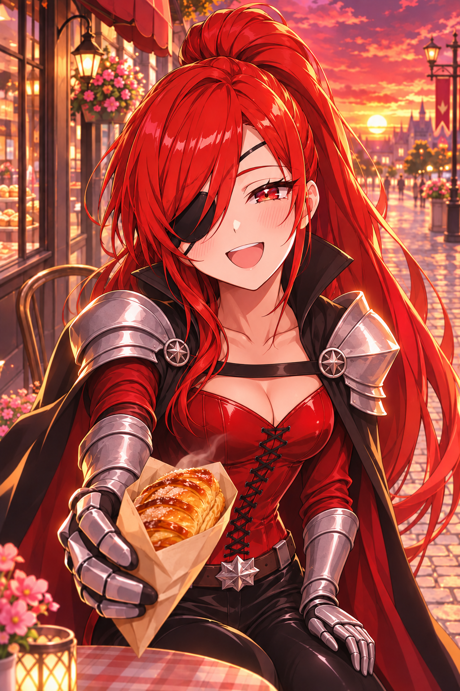
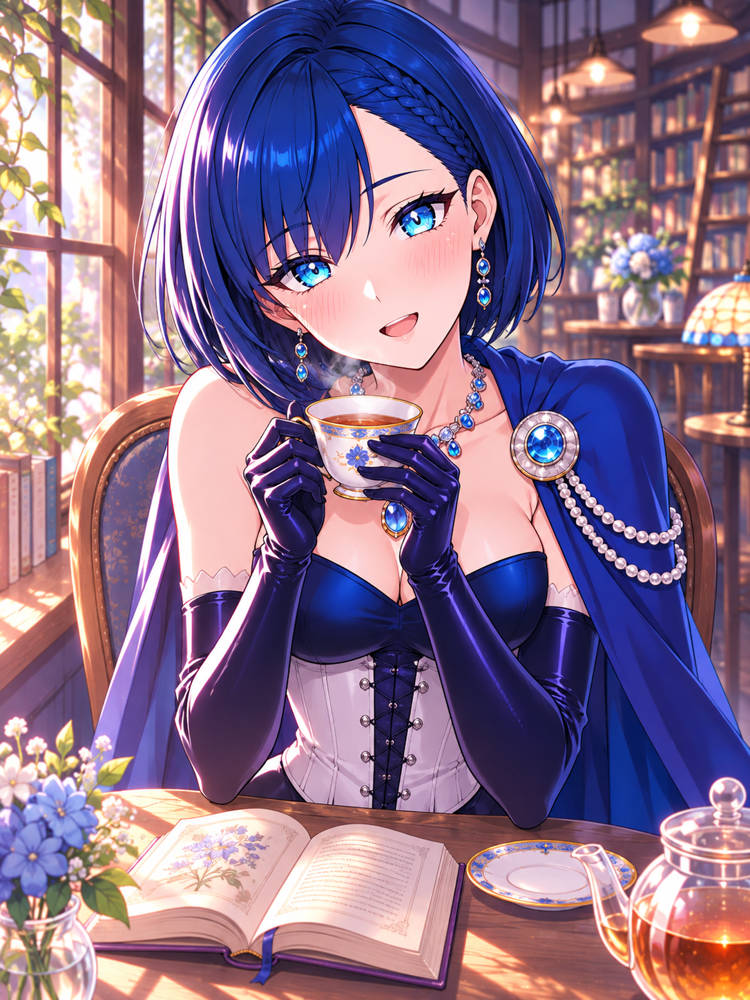
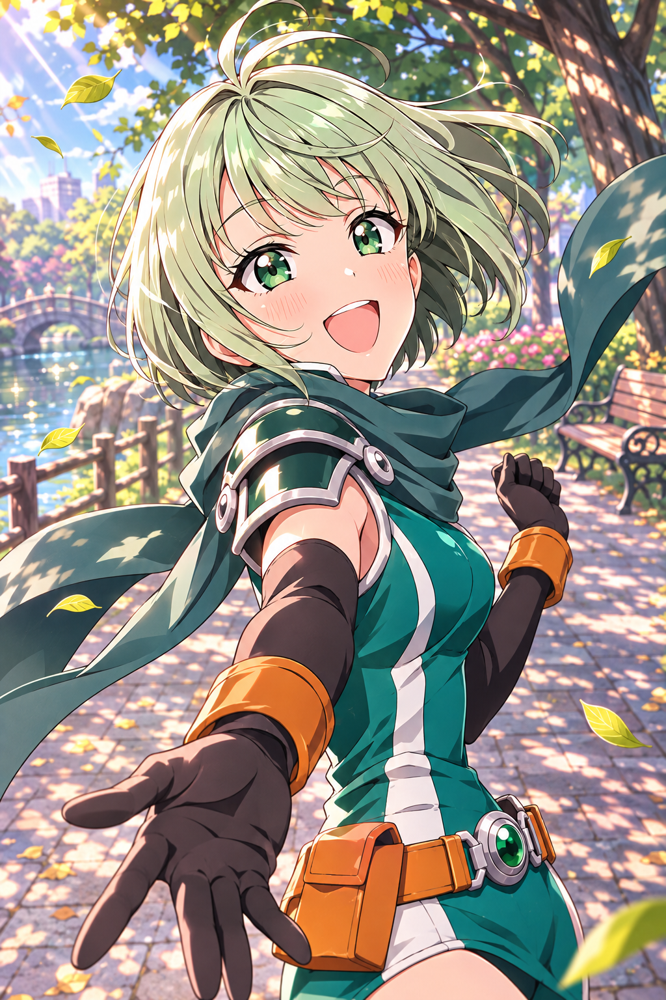
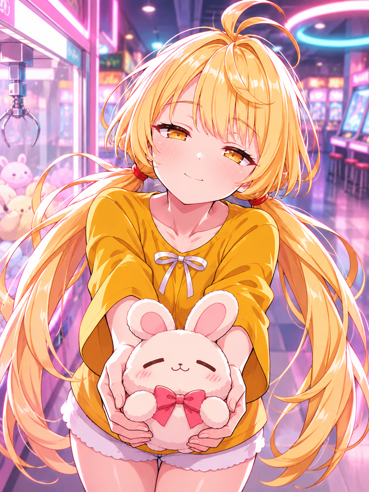
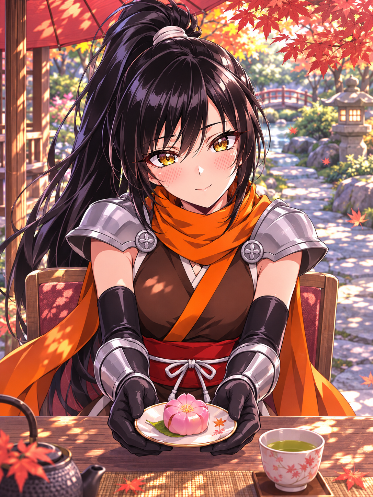
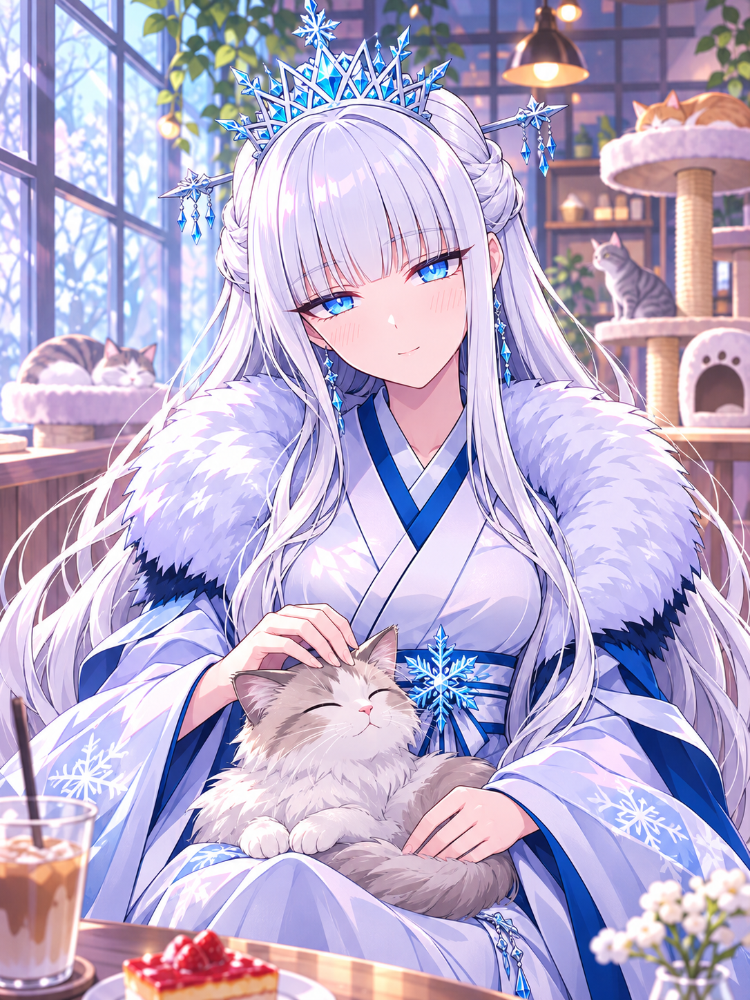
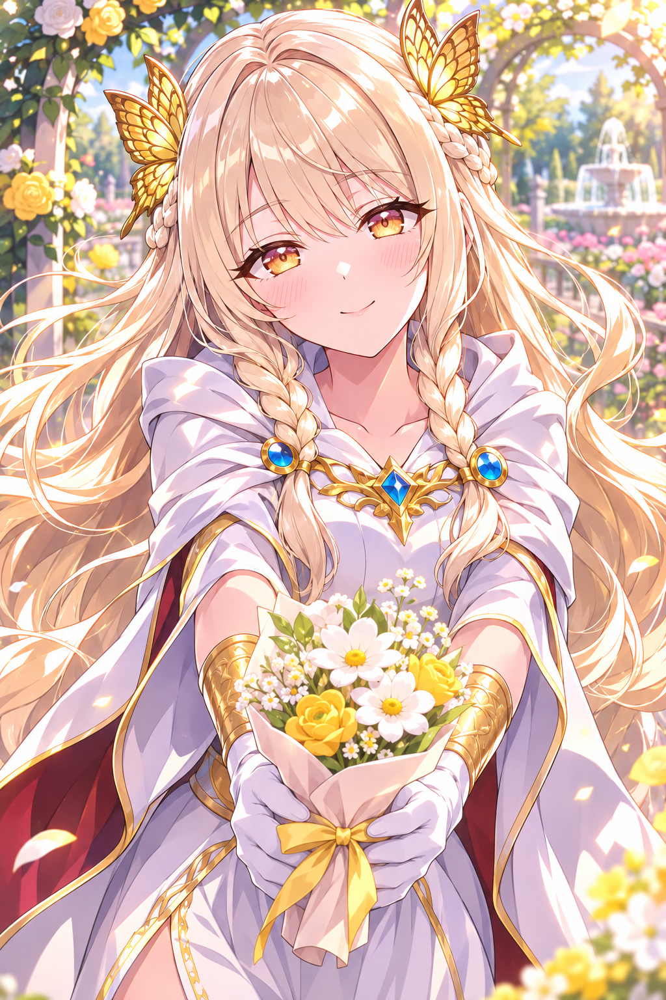

# 八星剣とのデート — ミカド目線

2026年11月15日制作。各ヒロイン1枚、計8枚のカラー一枚絵。ミカドを画面外の視点人物とし、ヒロインの目線や手の仕草でデートを表現しました。

キャラ原画像・設定と、`../reference-images/100kano-kyusai-all/` のカラー作画参考（生成時には01・38）を併用。衣装は登録画像を基準にしています。場所や小物は今回の演出であり、キャラの登録済み設定を追加・変更したものではありません。ユーザーレビュー未受領。

## ホムラ：夕暮れの街でパンを差し出す

手・腕の接続を修正した最新版です（右手でパンを差し出し、左手は膝に置いています）。

## スイ：書店カフェで紅茶

## フウ：公園で手を差し伸べる

## ライ：ゲームセンターで景品をプレゼント

## チカ：庭園の茶席で和菓子

## ユキ：猫カフェで静かなひととき

## ヒカリ：花園で小さな花束

## ヤミ：夜の水族館でクラゲを鑑賞

## ホムラの腕の修正（2026年11月15日）

ユーザーから腕の不自然さを指摘され、頬に触れる手と縦の前腕を除去。本人右肩からパンを差し出す右腕、本人左肩から膝へ下ろす左腕に修正しました。顔・本人右眼帯・夕景を維持し、画像生成による編集後に両腕のつながりを目視確認しました。修正前は `previous-versions/01-homura-before-arm-fix.png` に履歴保存しています。
