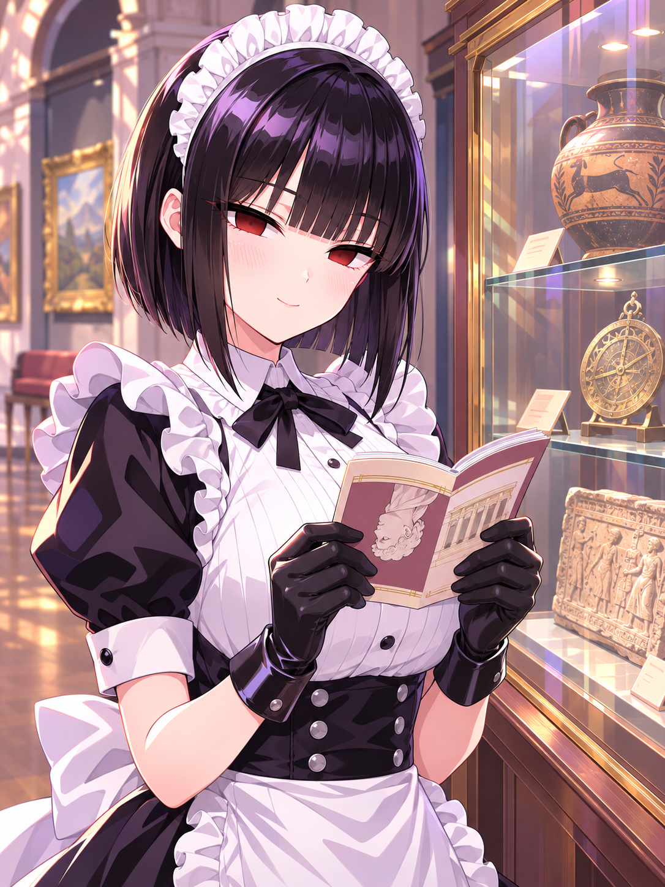
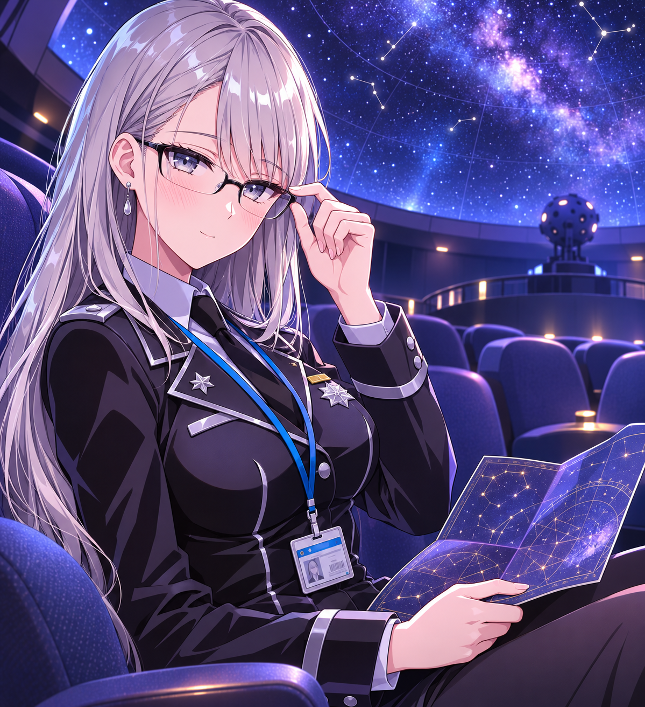
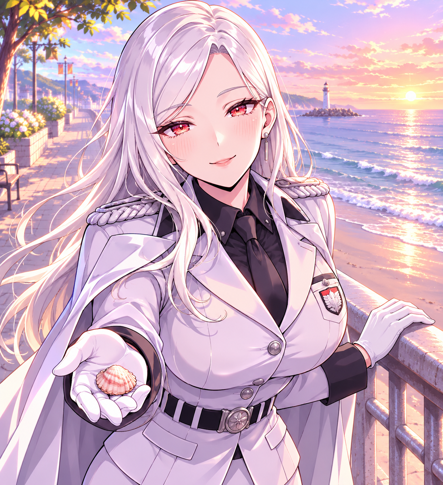
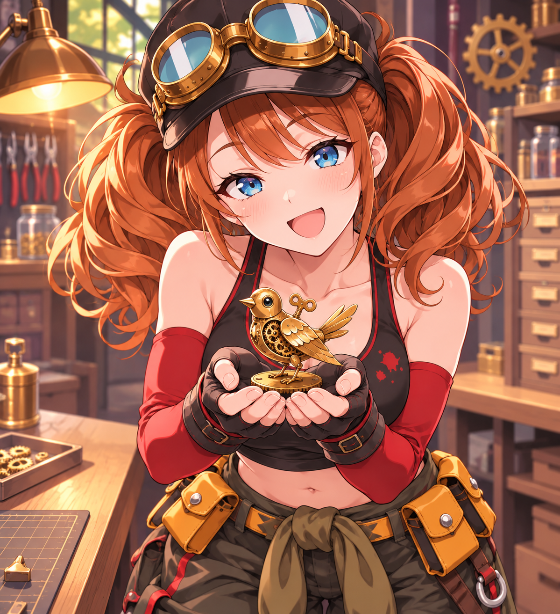
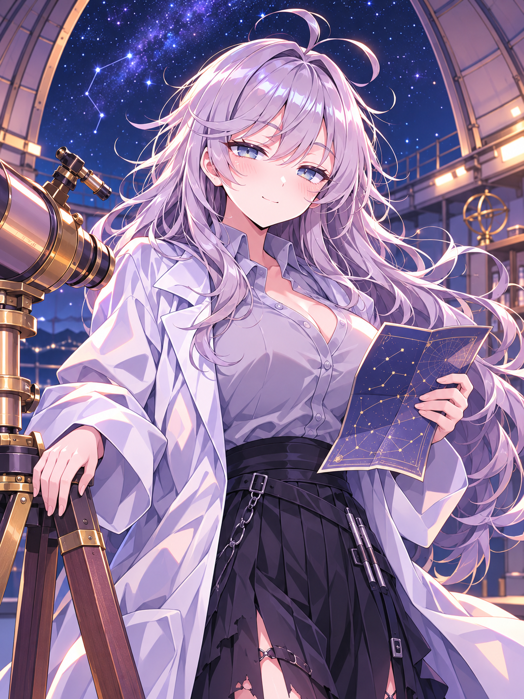

# パレスの人物たちとのデート — ミカド目線

2026年11月15日制作。八星剣8人・副官8人を除くパレスの人物9人を各1枚、計9枚制作しました。ミカド自身は画面外の視点人物。食事系を使わない条件を継続し、飲食物なしで描いています。ミコトは義妹としての設定を保った、親しい買い物のお出かけです。

各キャラの原画像と登録設定、追加カラー参考集 `../../reference-images/100kano-kyusai-all/` の01・38を併用。登録衣装を基準に生成。場所や小物は今回の演出であり、公式の設定追加ではありません。アエラ・ユリ等の異世界人物は本組の対象外です。ユーザーレビュー未受領。

## アヤメ：灯りの並ぶ広場で手品

## ミコト：アクセサリー選び

## メディ：美術館で古い品を鑑賞

## セナ：プラネタリウムで星を見る

## ケト：朝の海辺で貝殻を贈る

## ワイズ：古書店で本探し

## シズ：夕暮れの鐘楼で談笑

## シュミール：工房でからくり鳥を披露

## ミゼル：天文台で星空観察

## 確認範囲

全9枚を表示して目視確認し、原画像に基づく髪型・色・衣装・主要装飾、腕と小物、飲食物がないことを点検。メディの光のない赤い瞳、セナの黒縁眼鏡、ワイズの紫・緑メッシュ、シズの頬の縫合痕、シュミールの真鍮ゴーグルを確認しました。PNG全9枚のデコード、寸法、SHA-256を記録。背景の星図や機械は演出用で、科学的・機械的な精密図面ではありません。
